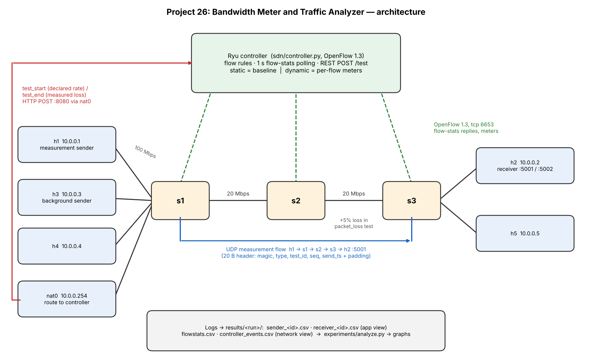

# Project 26: Bandwidth Meter and Traffic Analyzer

A UDP traffic generator and receiver running over a Mininet network controlled by a
Ryu (OpenFlow 1.3) controller. The project compares **application-level**
measurements (packets, bytes, throughput, loss, delay, jitter) with
**network-level** measurements (OpenFlow flow statistics polled every second), and
shows a controller that reacts to the measurements by rate-limiting flows with
OpenFlow meters. A static controller mode is the baseline.

## Architecture



```
 h1 (10.0.0.1, sender)  ─┐                                  ┌─ h2 (10.0.0.2, receiver)
 h3 (10.0.0.3, bg)      ─┼─ s1 ══ 20 Mbps ══ s2 ══ 20 Mbps ══ s3 ─┤
 h4 (10.0.0.4)          ─┤                                  └─ h5 (10.0.0.5)
 nat0 (10.0.0.254)      ─┘   access links 100 Mbps
                              │ OpenFlow 1.3 (tcp 6653)
                         Ryu controller  ◄── REST POST /test (tcp 8080, via nat0) ── sender / receiver
```

* **Data plane:** UDP packets from `app/sender.py` on h1 to `app/receiver.py` on h2
  (port 5001). Background traffic uses port 5002.
* **Control plane:** `sdn/controller.py` installs one rule per UDP flow, polls flow
  statistics every second and writes `flowstats.csv`.
* **Application to controller:** the sender posts `test_start` (with its declared
  target rate) and the receiver posts `test_end` (with measured loss) to
  `POST /test`. Hosts reach the controller through the NAT node at 10.0.0.254.
* **Dynamic reaction:** in `dynamic` mode every UDP rule goes through a meter. If a
  registered flow's measured rate exceeds its declared target (converted to
  frame bytes) by more than 20 % for 3 polls in a row, the controller sets the
  meter to the target rate (`rate_limit_on`). After 5
  polls below 50 % of the target, it lifts the limit (`rate_limit_off`).

## Folder map

| Path | Contents |
|---|---|
| `app/packet.py` | 20-byte packet header (pack/unpack) |
| `app/sender.py` | Paced UDP sender, logs `sender_<id>.csv` |
| `app/receiver.py` | UDP receiver: loss, duplicates, reordering, delay, jitter; logs `receiver_<id>.csv` |
| `app/ctrl_client.py` | Sends `test_start` / `test_end` to the controller |
| `app/test_local.py` | Local tests without Mininet |
| `sdn/topology.py` | Mininet topology (3 switches, 5 hosts, NAT) |
| `sdn/controller.py` | Ryu controller: forwarding, flow stats, REST API, meters |
| `experiments/run_experiment.py` | Runs experiments end to end from JSON configs |
| `experiments/configs/` | Experiment configs (sweeps and scenarios) |
| `experiments/analyze.py` | Builds graphs and summary tables from results |
| `results/` | Raw CSV logs, one folder per run, plus graphs |
| `docs/` | Interface spec, architecture diagram, report |

## Requirements

Tested with (fill in from `lsb_release -d; mn --version; ovs-vsctl --version | head -1; ryu-manager --version; python3 --version`):

* Ubuntu: 22.04.5 LTS
* Mininet: 2.3.0, Open vSwitch: 2.17.12
* Ryu: 4.34, Python: 3.10.12, plus `pandas` and `matplotlib`

```bash
sudo apt install mininet openvswitch-switch
pip install ryu pandas matplotlib   # Ryu needs an older eventlet; use the versions above
```

## Quick start (manual)

Order matters: `sudo mn -c` kills any running Ryu, so clean up first.

```bash
# Terminal 1
sudo mn -c
CONTROLLER_MODE=dynamic RESULTS_DIR=results/manual \
  ryu-manager --ofp-tcp-listen-port 6653 --wsapi-host 0.0.0.0 --wsapi-port 8080 sdn/controller.py

# Terminal 2
sudo python3 sdn/topology.py
```

In the Mininet CLI:

```
pingall
h2 python3 app/receiver.py --port 5001 --test-id 1 --log-dir results/manual --ctrl-url http://10.0.0.254:8080 &
h1 python3 app/sender.py --dst 10.0.0.2 --port 5001 --rate 10 --target-rate 5 --size 1000 --duration 15 --test-id 1 --log-dir results/manual --ctrl-url http://10.0.0.254:8080
sh ovs-ofctl -O OpenFlow13 dump-flows s1
sh ovs-ofctl -O OpenFlow13 dump-meters s1
sh cat results/manual/controller_events.csv
```

In dynamic mode this shows `rate_limit_on` and a 5000 kbps meter. The receiver
reports about 45 % loss, because the meter drops traffic above the declared 5 Mbps.

## Reproducing all results

```bash
sudo -v
python3 experiments/run_experiment.py --all              # every config, 3 repeats
python3 experiments/run_experiment.py --all --repeats 1  # faster
python3 experiments/run_experiment.py --all --dry-run    # print the plan only
python3 experiments/analyze.py                           # graphs + summary tables
```

Each run writes to `results/experiments/<name>_<mode>_r<rate>_s<size>_rep<n>_<time>/`:
`run_meta.json`, `sender_<id>.csv`, `receiver_<id>.csv`, `flowstats.csv`,
`controller_events.csv`, flow and meter dumps, and the controller and Mininet output.

| Config | What it does |
|---|---|
| `normal.json` | Smoke test: 5 Mbps, static |
| `load_sweep.json` | 1 to 25 Mbps at 1000 B, static and dynamic |
| `size_sweep.json` | 200/500/1000/1400 B at 5 Mbps, static and dynamic |
| `rate_limit.json` | Sends 10 Mbps but declares 5 Mbps |
| `congestion.json` | h3 sends 20 Mbps (declares 8) while h1 sends 10 Mbps |
| `packet_loss.json` | 5 % netem loss on the s2 to s3 link |

## Application options

```
sender.py   --dst IP [--port 5001] --rate MBPS [--size 1000] [--duration 10]
            [--test-id 1] [--log-dir .] [--ctrl-url URL | --no-ctrl]
            [--target-rate MBPS] [--drop-prob P --seed N]
receiver.py [--bind 0.0.0.0] [--port 5001] [--test-id 1] [--idle-timeout 3]
            [--start-timeout 120] [--log-dir .] [--ctrl-url URL | --no-ctrl]
```

`--drop-prob` makes the sender skip packets on purpose, to check that the receiver
detects loss. Run `python3 app/test_local.py` to run the local tests.

## Key formulas

* Throughput (Mbps) = bytes × 8 / seconds / 10^6
* Loss % = (expected − received) / expected × 100, where expected = max(max_seq + 1, total from END packet)
* Frame bytes on the wire = UDP payload + 42 (UDP 8 + IP 20 + Ethernet 14)
* Expected network / application throughput ratio = (payload + 42) / payload (1.042 for 1000 B)

## Interfaces

Packet format, REST messages and CSV formats: [docs/INTERFACES.md](docs/INTERFACES.md).

## Troubleshooting

* `pingall` 100 % dropped: switches are not connected. Check
  `sudo ovs-vsctl show | grep is_connected`. Start Ryu after `sudo mn -c`, on port 6653.
* `sudo: a password is required` from the runner: run `sudo -v` first.
* Controller unreachable from hosts: use `--ctrl-url http://10.0.0.254:8080`. The app
  logs a warning and keeps measuring if the controller is down.

## Limitations

* Python pacing becomes inaccurate at high packet rates (small packets at high
  Mbps). The sender warns when the achieved rate is more than 5 % below the target.
* When the offered load exceeds the 20 Mbps core link, Linux pushes back on the
  sender (ENOBUFS) instead of dropping packets in the switch. The sender waits and
  retries, so the test runs longer and the achieved rate drops to the link
  capacity. The analysis uses the real elapsed time of each flow, not the planned
  duration.
* Flow statistics are polled once per second, so the network curve can be shifted
  by up to one interval relative to the application curve.
